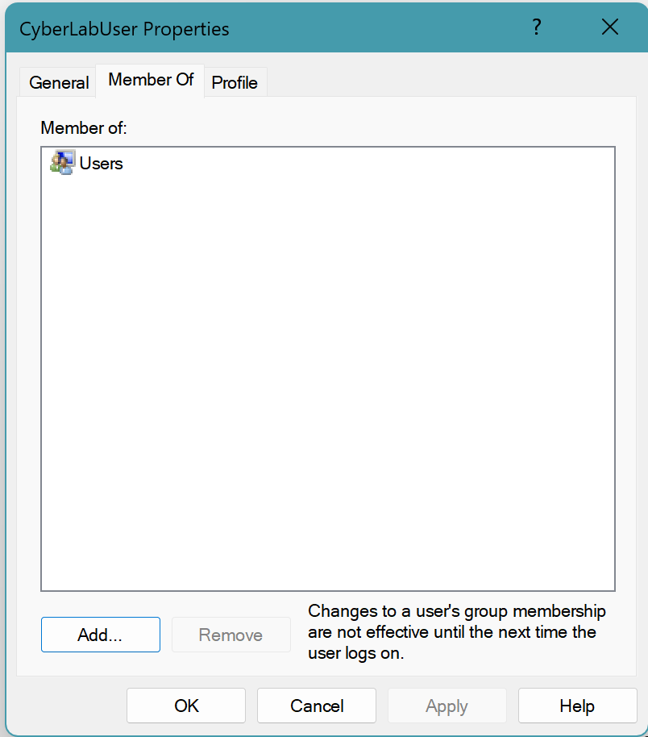
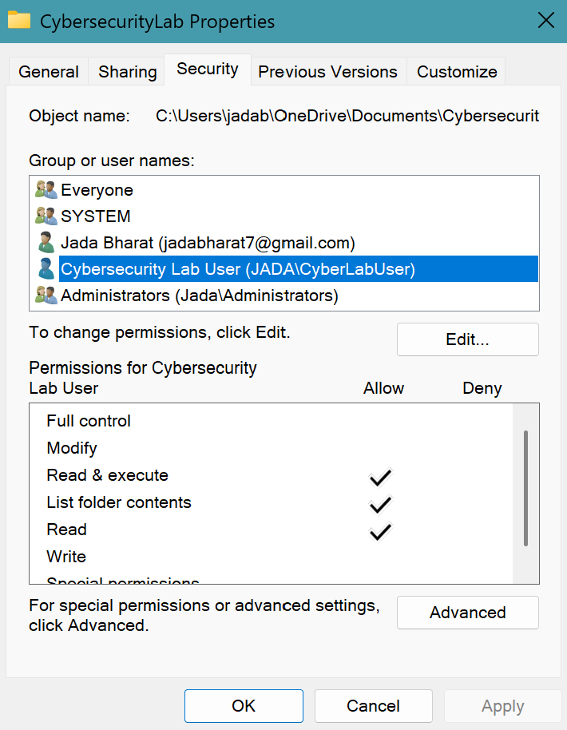
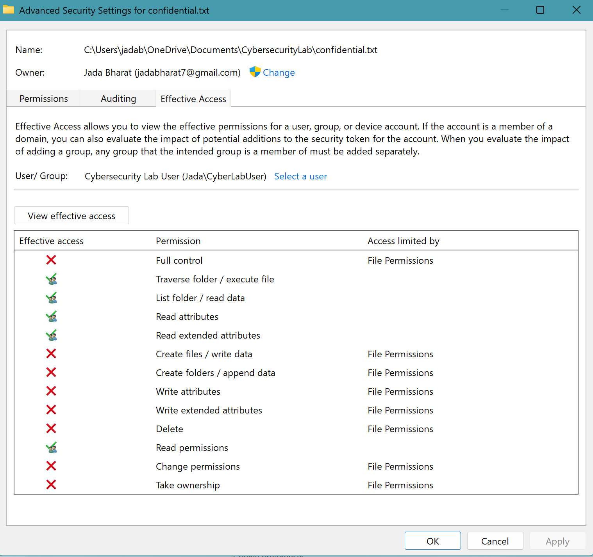

# Windows Access Control Lab

## Overview

This project demonstrates Windows user account management and file access control using NTFS permissions. I created a separate local user account, applied the principle of least privilege, configured read-only access to a protected file, and reviewed the account's effective permissions.

## Tools Used

- Windows
- Computer Management
- Local Users and Groups
- NTFS File Permissions
- Advanced Security Settings

## 1. Creating a Standard User

I created a local account named `CyberLabUser` specifically for this lab. The account was kept as a standard user and was only a member of the `Users` group rather than the `Administrators` group.

This demonstrates the principle of least privilege by avoiding unnecessary administrative access.

## 2. Configuring Read-Only Access

I created a protected folder and configured permissions for `CyberLabUser`.

The account was granted:

- Read & execute
- List folder contents
- Read

The account was not explicitly granted:

- Full control
- Modify
- Write

## 3. Verifying Effective Access

I used Windows Advanced Security Settings to review the effective permissions for `CyberLabUser` on `confidential.txt`.

The results showed that the account could read the file but did not have permissions to write data, delete the file, change permissions, take ownership, or obtain full control.

## Security Concepts Demonstrated

- Principle of least privilege
- User authentication and account management
- NTFS permissions
- File access control
- Effective permissions
- Authorization
- Separation of standard and administrative privileges

## What I Learned

This lab helped me understand how Windows permissions can be used to control access to files and resources. I also learned the importance of checking effective permissions instead of relying only on individual permission entries, since a user's final level of access can depend on multiple security groups and inherited permissions.

## Disclaimer

This lab was completed in my own Windows environment using a temporary local account created specifically for educational purposes.
